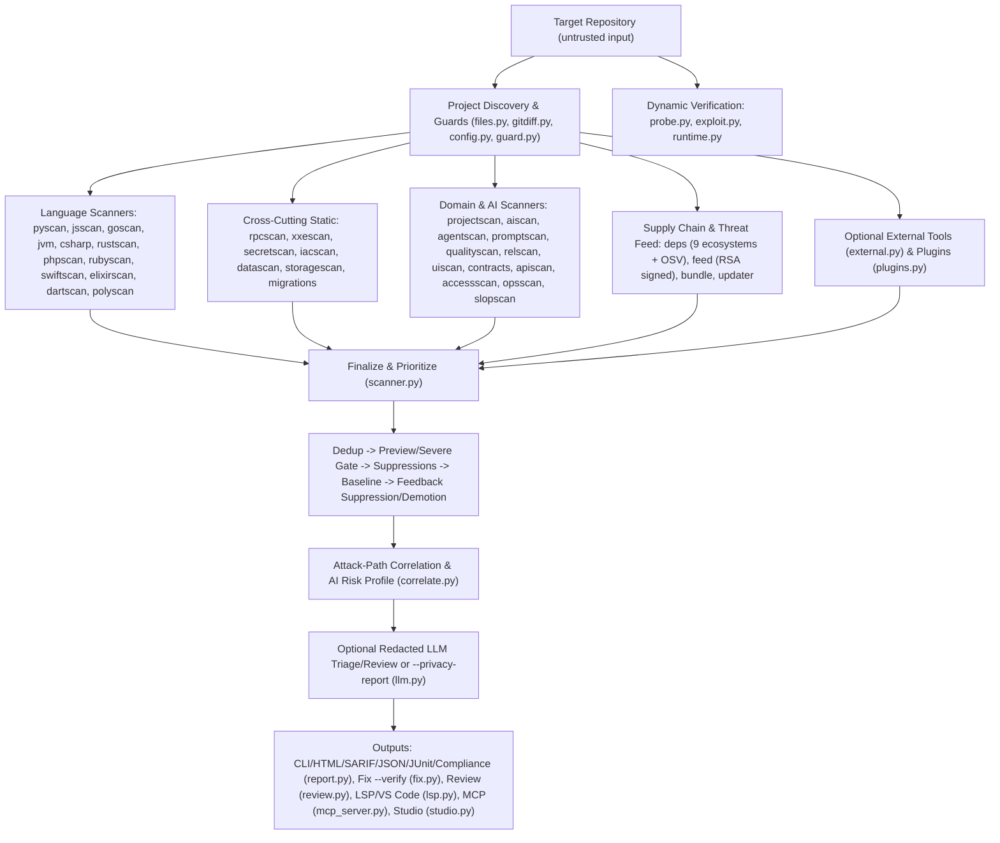

# vibeaudit -- Complete Project & Architecture Reference (`v0.19.0`)

**vibeaudit** is a zero-runtime-dependency (Python 3.11+) security, AI-agent safety, and production-readiness platform written in pure Python. It audits full repositories -- backend APIs, frontend bundles, database migrations and SQL/NoSQL queries, infrastructure manifests, CI workflows, dependency trees, LLM prompts, and MCP tool definitions -- without executing scanned code.

This document summarizes everything implemented across the entire repository as of **`v0.19.0`**.

---

## 1. Project Snapshot & Metrics

| Dimension | Verified Count / Details (`v0.19.0`) |
| --- | --- |
| Package version | `0.19.0` (`src/vibeaudit/__init__.py`) |
| Core Python codebase | `76` modules in `src/vibeaudit/`, `25,500+` lines total |
| Runtime dependencies | None (Python 3.11+); optional `vibeaudit[parse]` for tree-sitter (Go, Rust, Java, JS/TS) |
| Security & quality rules | `180` rules (`95` stable static, `84` preview, `7` severe-gating preview) across `12` static categories + `1` LLM review (`AI001`) |
| Compliance frameworks | `6`: `owasp`, `owasp-llm`, `eu-ai-act`, `soc2`, `hipaa`, `gdpr` (`data/compliance_map.json`) |
| Language & stack coverage | Python, JavaScript/TypeScript (React, Next.js, Vue, Svelte, Astro), Go, Java/Kotlin, C#/.NET, Rust, PHP, Ruby/Rails, Dart/Flutter, Swift/iOS/Vapor, Elixir/Phoenix |
| RPC & IaC coverage | tRPC, GraphQL, gRPC; Dockerfile, Docker Compose, Kubernetes, GitHub Actions, Terraform (AWS, GCP, Azure), AWS CloudFormation, Firebase/Supabase rules |
| Package ecosystems | `9`: `PyPI`, `npm`, `Go`, `Maven`, `crates.io`, `NuGet`, `Packagist`, `Pub`, `RubyGems` |
| CLI subcommands | `16`: `scan`, `routes`, `watch`, `review`, `fix`, `mcp`, `lsp`, `studio`, `explain`, `test-exploit`, `probe`, `rules`, `doctor`, `init`, `update`, `feedback` |
| Deterministic codemods | `12` auto-fix rules (`AUTH011`, `BE011`, `BE012`, `BE013`, `BE016`, `CSHARP003`, `DATA004`, `DATA013`, `GO002`, `LLM003`, `LLM011`, `REL001`) + `--verify` rollback |
| Report & IDE outputs | `16` renderer keys across `15` formats (`json`, `sarif`, `md`/`markdown`, `html`, `prompt`, `badge`, `junit`, `codeclimate`, `aibom`, `compliance:*`), LSP + VS Code/Cursor extension, Studio local web UI, `10` MCP tools |
| Test & benchmark suite | `93` test files (`tests/test_*.py`), `15` utility scripts (`tools/*.py`), `6` GitHub Actions workflows, `142`-repo precision benchmark + `255` GHSA advisories + `17` pinned advisory locations |

---

## 2. End-to-End Architecture & Scan Pipeline

### How a Scan Runs (`scanner.py`: `scan` -> `_scan_project` -> `finalize`)

1. **Configuration & Scope (`config.py`, `files.py`)**: Reads `.vibeaudit.toml` or `[tool.vibeaudit]` in `pyproject.toml` (unless `--no-config`), collects git-tracked/non-ignored files within `max_file_bytes` (or `--monorepo` per-package sub-projects in `monorepo.py`), rejects escaping symlinks, and loads custom `auth-helpers`, `sanitizers`, and `public-paths` into `heuristics.CUSTOM`.
2. **File-Timeout & Incremental Cache Guard (`guard.py`)**: Every scanner step executes inside `GUARD.run()` with a per-file wall-clock budget and periodic `GUARD.tick()` checks to abort runaway inputs gracefully. In long-lived processes (`watch.py`, `lsp.py`), `StepMemo` replays unchanged per-file results in sub-second incremental scans.
3. **Route & Entry-Point Discovery**: Language scanners (`PyScanner`, `JsScanner`, `GoScanner`, `JvmScanner`, `CsScanner`, `RustScanner`, `PhpScanner`, `RubyScanner`, `SwiftScanner`, `ElixirScanner`, `PolyScanner`) and `rpcscan.routes()` (tRPC, GraphQL, gRPC) emit canonical `Route` records carrying HTTP methods, normalized paths, parameters, `has_auth`, `auth_evidence` hints, data-mutation flags, and `calls_llm`.
4. **Static, Infrastructure & Supply-Chain Analyzers**:
   - `XxeScanner`, `SecretScanner`, `ProjectScanner`, `QualityScanner`, `DataScanner`, `ReliabilityScanner`, `AiScanner`, `UiScanner`, `ContractScanner`, custom `plugins.run()`, `DepScanner` (`9` ecosystems against PyPI/npm/Pub/RubyGems registries, OSV API/offline index, and signed threat-feed data), and optional external tools (`gitleaks`, `osv-scanner`, `bandit`, `semgrep`) all emit raw `Finding` objects.
5. **Finalization (`finalize`)**:
   - Hydrates rule metadata (`title`, `category`, `severity`, `why`, `fix`, `cwe`, `owasp`) and preview status from `rules.RULES`.
   - Applies per-language preview status (non-stable language findings default to preview; severe injection/XSS classes retain `gates_in_preview=True` unless disabled).
   - Filters out non-credential test/example findings, applies inline `vibeaudit: ignore[...]` suppressions, deduplicates external tool overlaps against built-in findings, prioritizes cross-function taint traces over local findings, and computes stable normalized-snippet SHA-256 fingerprints (`compute_fingerprint()`).
   - Filters against `--baseline`, `--diff` / `--staged`, and `.vibeaudit/feedback.json` (plus auto-demoting rules with `>30%` false-positive rate across `>=3` reviewed verdicts).
   - Attaches `meta.attack_paths` and `meta.ai_risk_profile` via `correlate.py` and optionally runs redacted LLM triage/review via `llm.py`.

---

## 3. Complete Module Inventory (`src/vibeaudit/` -- 76 Modules)

### A. Core Engine, Filesystem & Helpers (`15` modules)

| Module | Lines | Purpose |
| --- | --- | --- |
| `__init__.py` | 45 | Public package API (`scan`, `Options`, `project_options`, `Result`, `Finding`, `Route`, plugin decorators, `FastAPIMiddleware`) and `__version__` (`0.19.0`). |
| `__main__.py` | 5 | Entry point for `python -m vibeaudit`. |
| `model.py` | 124 | Core dataclasses `Finding`, `Route` (including `auth_evidence` extraction in `to_dict()`), severity ranking, inline suppression regex, and path joining. |
| `files.py` | 543 | Git-aware workspace enumeration, symlink escape prevention, language/kind classification, test/example/vendored heuristics, `SourceFile` line caches, and `StepMemo` read/value tracking. |
| `guard.py` | 170 | Per-file timeout enforcement, loop tick budget, error isolation (`meta.internal_errors` / `meta.skipped`), and `StepMemo` replay engine. |
| `config.py` | 122 | Strict TOML config parser (stdlib `tomllib`) validating types and unknown keys in `.vibeaudit.toml` / `pyproject.toml`. |
| `heuristics.py` | 249 | Shared security patterns: `AUTH_EVIDENCE`, `AUTH_MIDDLEWARE`, `ADMIN_ROLE_EVIDENCE`, `OWNERSHIP_EVIDENCE`, `PUBLIC_PATH`, `WEBHOOK_*`, `RATE_LIMIT_EVIDENCE`, entropy secret detection, and `CUSTOM` config state. |
| `lexer.py` | 309 | Offset-preserving comment/string blanking views (`Views`), JS/TS template/comment lexer, Python lexer view, bracket matching (`match_close`), argument splitting, and `ident_re`. |
| `parse.py` | 187 | Optional `vibeaudit[parse]` tree-sitter function and parameter indexer for Go, Rust, Java, JS, TS, and TSX (falls back cleanly to regex if unavailable or `VIBEAUDIT_PARSER=regex`). |
| `calls.py` | 146 | Generic cross-file call-graph / brace-language flow helper used to follow tainted request data across helper calls into file/URL/redirect sinks. |
| `scanner.py` | 430 | Top-level scan orchestrator (`scan`, `_scan_project`, `finalize`, `_stack` detection, bounded `--history` git-log status reporting, baseline loading). |
| `monorepo.py` | 153 | Per-package workspace splitting (`--monorepo`) scanning each sub-package against its own manifest while sharing repo-wide checks (`QA002`, `DATA007`, lockfiles). |
| `gitdiff.py` | 89 | Computes changed/staged file lines via `git diff` (`--diff REV`, `--staged`) so whole-project context runs while reporting only changed lines. |
| `store.py` | 131 | Platform cache directory helpers, atomic file writes (`write_atomic`), `TimedCache`, and safe JSON parsing. |
| `stdlib.py` | 26 | Python stdlib module-name list used for detecting missing imports vs declared packages. |

### B. Language, Framework & Query Scanners (`17` modules)

| Module | Lines | Purpose |
| --- | --- | --- |
| `pyscan.py` | 1,639 | Real Python AST + 3-hop cross-file taint engine (`user`, `llm`, `tool` taint); context-sensitive & AugAssign-safe sanitizers (`html`, `shell`, `path`, `url`, `redirect`, `sql`, `code`, `nosql`), strict boolean/resolved path guards (`_path_guarded`), `getattr()`/`globals()` dynamic dispatch sinks (`BE003`); Flask/FastAPI/Django/DRF route & prefix resolution; SQL (`BE001`), PyMongo/Motor & `$where` (`BE010`), Cypher & KQL (`BE022`), shell, eval/sympy, path, SSRF, SSTI, redirect, deser, JWT, logging, stubs, agent loops & MCP tools. |
| `jsscan.py` | 1,392 | Offset-preserving JS/TS/JSX/TSX/Vue/Svelte/HTML scanner; scoped fixpoint + 3-round cross-file call taint; span-scoped context-sensitive sanitization (`_strip_sanitizer_calls`, restricting `nosql` to scalar `String`/`z.string`/refinements and `{ $eq }`); Express/Next.js App & Pages/SvelteKit/Supabase Edge/Firebase (`onRequest`, `onCall`) routes; SQL, Cypher/KQL (`BE022`), NoSQL & `$where` (`BE010`), mass assignment, shell, eval, SSRF, path, redirect, HTML/DOM sinks, CORS, JWT, LLM checks. |
| `goscan.py` | 788 | Lexer/parser-backed Go scanner (`net/http`, Gin, Echo, Fiber, Chi, GORM); tracks nested `.Group()` / `.Route()` / local variable `.Mount()` middleware propagation; checks Go-specific `GO001`--`GO004` + injection, auth, TLS, timeouts, and concurrent map writes. |
| `jvm.py` | 517 | Java & Kotlin scanner (Spring Boot, Spring Security filter chains, JAX-RS/Quarkus, Hibernate/JDBC); extracts annotated controllers and tracks data flow into sinks (`JAVA001`--`JAVA004`, auth, SQL/cmd injection). |
| `jvmconfig.py` | 77 | Spring `application.properties` / `application.yml` configuration checks (`JAVA002` exposed Actuator endpoints, insecure settings). |
| `jvmsinks.py` | 231 | Shared Java/Kotlin method-body sink checks (SQL, command, XXE helpers, path, SSRF, redirects, timeouts). |
| `csharp.py` | 356 | ASP.NET Core MVC controller & Minimal API (`MapGet`/`MapPost`/...) route discovery, `[Authorize]` / `RequireAuthorization` / service-layer ownership checks, EF Core & `CSHARP001`--`CSHARP003`. |
| `cssinks.py` | 172 | Shared C# sink analysis for SQL (`FromSqlRaw`/`ExecuteSqlRaw`), process execution, path, SSRF, redirect, and XSS sinks. |
| `rustscan.py` | 537 | Actix-web & Axum scanner (`#[get]`/`Router::route`, extractor auth guards, test-module stripping via `rust_views` / `without_test_modules`, `tokio-postgres`/`sqlx`/`diesel` SQLi, command injection, TLS/timeouts). |
| `phpscan.py` | 770 | Laravel & Symfony scanner (route groups, middleware, `Gate`/`Policy`/`IsGranted`, Blade `{!! !!}` with model-escaping caching, Eloquent/PDO SQLi, shell, SSRF, path). |
| `rubyscan.py` | 462 | Ruby on Rails scanner (`config/routes.rb` resources/namespaces, controller `before_action` inheritance with `only:`/`except:`/`skip_before_action`, ActiveRecord SQLi, shell, `constantize`, `Marshal`/`YAML.load`, `permit!`, ERB `raw`/`html_safe`). |
| `dartscan.py` | 116 | Flutter & Dart preview scanner (`badCertificateCallback`, SQFlite raw SQL interpolation, `SharedPreferences` secrets, WebView JS / `JavaScriptMode.unrestricted`, client LLM calls, HTTP `.timeout()`, Android `AndroidManifest.xml`, iOS `Info.plist`). |
| `swiftscan.py` | 205 | Swift, iOS & Vapor preview scanner (`Package.swift` / Vapor `.get/.post/...` + `.grouped` middleware auth, SQLKit/SQLite string interpolation, `Process()` shell injection, `URLCredential`/`DisabledTrustEvaluator`/`Info.plist` TLS bypass, `UserDefaults` secrets, client LLM calls). |
| `elixirscan.py` | 167 | Elixir & Phoenix preview scanner (`mix.exs` / Phoenix `router.ex` `scope` + `pipe_through` auth pipelines, Ecto `SQL.query`/`fragment` interpolation, `:os.cmd`/`System.cmd`, unsafe `:erlang.binary_to_term` without `[:safe]`, `Phoenix.HTML.raw` XSS, `verify: :verify_none`). |
| `polyscan.py` | 368 | Polyglot language classification (`POLY_STABLE`, `POLY_SEVERE`, `_lang_of`), Go/Java/C#/Rust/PHP N+1 loop queries (`DATA001`), missing HTTP timeouts (`REL001`), and supplementary polyglot checks. |
| `rpcscan.py` | 252 | Canonical route discovery for tRPC (`publicProcedure` vs `.use(...)` / `protectedProcedure`), GraphQL (Apollo/Strawberry/Graphene resolvers + shield/directive auth), and gRPC services (Go, Python, Node, Java/Kotlin interceptors). |
| `xxescan.py` | 119 | Multi-language XML External Entity (`BE021`) scanner covering Python (`lxml`, `xml.sax`), Java/Kotlin XML factories without DTD hardening, C# (`DtdProcessing.Parse`, `XmlUrlResolver`), PHP (`LIBXML_NOENT`, `libxml_disable_entity_loader(false)`), and JS/TS (`libxmljs` `noent: true`). |

### C. Domain, AI/Agent, Infrastructure & Supply-Chain Scanners (`20` modules)

| Module | Lines | Purpose |
| --- | --- | --- |
| `secretscan.py` | 431 | Provider API keys, private keys, default signing secrets, DB URLs with passwords, committed/un-ignored `.env`, browser `NEXT_PUBLIC_`/`VITE_` secrets, entropy/password literals, plus opt-in `--history` git-commit secret scanning (`scan_git_history`). |
| `projectscan.py` | 523 | Project-wide checks: auth/role/IDOR/webhook/rate-limit rules across canonical routes (`AUTH001`--`AUTH004`, `AUTH010`, `AUTH018` Next.js middleware matcher gaps, `BE018`), Supabase SQL RLS, Firebase rules, MCP JSON configs, Docker/Compose/Workflows, missing tests/CI, Express `helmet()`. |
| `iacscan.py` | 266 | Infrastructure-as-Code scanner: Kubernetes (privileged pods, `hostPath`, missing limits), AWS CloudFormation, and Terraform across **AWS** (`CFG014`--`CFG016`), **GCP**, and **Azure** (`CFG020`). |
| `datascan.py` | 466 | Data & database scanner: Python/JS/SQL N+1 loops, over-fetched user objects (`DATA002`), destructive migrations (`DATA003`), float money columns (`DATA004`), Postgres naive timestamps (`DATA006`), undocumented env vars (`DATA007`), per-request Prisma clients (`DATA008`), serverless SQLite (`DATA009`), multi-write routes without transactions (`DATA010`), migration index locking (`DATA011`), FK indexing (`DATA012`), Redis TTL (`DATA013`), Docker build secrets (`CFG017`). |
| `storagescan.py` | 193 | Cloud/framework object storage and bucket ACL/presigned upload checks (`DATA014`--`DATA016` / public storage patterns). |
| `migrations.py` | 260 | Database migration risk analyzer + MCP `simulate_migration` backend: inspects pending SQL/Prisma/Alembic/Django migrations for destructive drops, lock risk, and backfill hazards. |
| `relscan.py` | 137 | Reliability checks (`REL001`--`REL006`): unbounded HTTP timeouts, unhandled async/promise errors, pagination limits, upload size limits, serverless in-memory state, health-check endpoints. |
| `qualityscan.py` | 601 | AI-generated code completeness (`QA001`--`QA011`): unimplemented stubs, swallowed exceptions, missing imports/names (`QA006`--`QA007`), duplicate functions (`QA009`), Next.js App vs Pages router mixups (`QA010`), mock fallback data (`QA011`). |
| `slopscan.py` | 256 | Security/code-slop heuristics for hallucinated imports, placeholder fallbacks, and brittle generated patterns (`SLOP` / `QA` signals). |
| `uiscan.py` | 429 | React, Next.js, Vue, Svelte, and HTML accessibility & UX checks (`UI001`--`UI017`): `alt` text, keyboard click handlers, labels, dead buttons, array-index keys, hydration mismatches, missing error/metadata/viewport, broken links/assets. |
| `contracts.py` | 139 | Frontend-backend contract checker (`API001`--`API002`): matches client `fetch`/`axios` calls against discovered backend routes to detect 404/405 mismatches. |
| `apiscan.py` | 98 | API hygiene checks across canonical routes: JWT algorithm pinning (`AUTH011`), SameSite cookies (`AUTH012`), webhook replay timestamps (`AUTH013`), rate-limit header spoofing (`AUTH014`), session invalidation (`AUTH015`), tenant scoping (`AUTH016`), admin/feature-flag role checks (`AUTH017`), client-trusted payment amounts (`BE019`), email header injection (`BE020`). |
| `accessscan.py` | 151 | Tenant/resource isolation and object-level access checks (`AUTH016` / role-gated endpoint analysis). |
| `opsscan.py` | 146 | Operational security configuration checks (`CFG` / CI hardening, workflow `pull_request_target` / permissions checks). |
| `aiscan.py` | 116 | Retired/deprecated AI model detection (`LLM012` using live threat feed + `retired_models.txt`) and AI-specific code patterns. |
| `agentscan.py` | 216 | Agent & MCP security scanner: agent permission/budget bounds (`LLM013`--`LLM024`), MCP tool poisoning (`LLM027`: `<IMPORTANT>`, exfiltration directives in docstrings/JSON schemas), and dynamic un-allowlisted tool dispatch (`LLM028`: `globals()[name]`, `getattr(..., name)`, `globalThis[name]`). |
| `promptscan.py` | 173 | Agent instruction-file prompt injection scanner (`CLAUDE.md`, `.cursorrules`, `.windsurfrules`, etc. -> `LLM025`) driven by signed threat-feed patterns + shipped signatures. |
| `deps.py` | 1,136 | Supply-chain analyzer across all `9` ecosystems (`PyPI`, `npm`, `Go`, `Maven`, `crates.io`, `NuGet`, `Packagist`, `Pub`, `RubyGems`): manifest + lockfile parsing, typosquatting (`DEP002`), slopsquatted / non-existent packages (`DEP001`), new package age (`DEP003`), OSV direct & transitive CVEs (`DEP004`, `DEP009`), install scripts (`DEP006`), pinned MCP servers (`DEP007`), extra indexes (`DEP008`). |
| `external.py` | 169 | Optional integration & deduplication for external CLI scanners (`gitleaks`, `osv-scanner`, `bandit`, `semgrep`). |
| `plugins.py` | 143 | Python Plugin SDK (`@rule`, `@route_rule`, `@file_rule`, custom rule loading via `--plugin`). |

### D. Correlation, Remediation, Explainability & Feedback (`5` modules)

| Module | Lines | Purpose |
| --- | --- | --- |
| `correlate.py` | 85 | Correlates individual findings/routes into high-severity multi-step `attack_paths` (`unauthenticated-exploit-chain`, `agentic-prompt-to-action`, `client-to-backend-privilege`) and computes `ai_risk_profile` counts. |
| `fix.py` | 1,022 | Deterministic AST/lexer codemods (`Plan`, `plan_findings`, `FIXERS` for `12` rules), parse/balance guards, line-ending/BOM preservation, `--verify` re-scan with automatic rollback (`verify_plan`), and optional `--llm` `.patch` export. |
| `explain.py` | 352 | Data-flow path explainer (`vibeaudit explain FILE:LINE`) tracing how tainted input entered and reached a sink across calls. |
| `llm.py` | 300 | Optional stdlib-HTTP LLM triage/review (`gemini`, `openai`, `openrouter`, `anthropic`) with defaults loaded from `data/llm_models.json`, aggressive `redact()` secret masking, verdict caching, untrusted-code prompt hardening, and zero-network `--privacy-report`. |
| `feedback.py` | 206 | Per-repo feedback store (`.vibeaudit/feedback.json`): records confirmed/false-positive verdicts, hides reviewed false positives, auto-demotes noisy rules (`>30%` FP over `>=3` verdicts), exports pytest regression suites (`feedback export`), and proposes `.vibeaudit.toml` `auth-helpers` diffs (`feedback suggest-helpers`). |

### E. Dynamic Probing & Staging Runtime (`3` modules)

| Module | Lines | Purpose |
| --- | --- | --- |
| `probe.py` | 793 | Non-destructive dynamic DAST prober: localhost-only safety guard (unless `--i-own-this-target`, verifying TLS by default on remote HTTPS targets), route discovery + OpenAPI + plain PHP + GraphQL schema introspection, JSON & HTML-form/CSRF login, two-user IDOR comparison, SQLi/XSS/SSRF-canary/CORS/missing-header/stacktrace/system-prompt-leak checks, and source-finding confirmation (`probe.merge`). |
| `exploit.py` | 257 | `vibeaudit test-exploit` safe canary proof-of-concept request builder and localhost-only non-redirecting executor. |
| `runtime.py` | 164 | `FastAPIMiddleware` & Express double-gated staging observability middleware (`VIBEAUDIT_RUNTIME=1`) confirming live route reachability without running in production by default. |

### F. Threat Intelligence & Offline Air-Gapped Bundles (`3` modules)

| Module | Lines | Purpose |
| --- | --- | --- |
| `feed.py` | 270 | Pure-stdlib RSA PKCS#1 v1.5 SHA-256 verification against `data/feed_key.json`, merging live signed `threat_feed.json` with shipped `threat_data.json`, enforcing size bounds (`MAX_FEED_BYTES`), format/expiry/signature/anti-rollback via `validate_install()`. |
| `updater.py` | 144 | `vibeaudit update` client fetching `pypi_top.txt.gz`, `npm_top.txt.gz`, `retired_models.txt`, signed `threat_feed.json`, and cache invalidation. |
| `bundle.py` | 310 | Air-gapped `--export` / `--import` zip bundles carrying data lists, signed feed (checked via `feed.validate_install`), and compact per-ecosystem OSV JSON indices with SHA-256 manifest verification. |

### G. Rules, Compliance, Reporting & User Interfaces (`13` modules)

| Module | Lines | Purpose |
| --- | --- | --- |
| `rules.py` | 1,037 | Master catalog of all `180` rules (`Rule` dataclass, `CATEGORIES`, `PREVIEW`, `gates_in_preview`, `SECURITY_SEVERITY`). |
| `compliance.py` | 136 | Maps findings against `owasp`, `owasp-llm`, `eu-ai-act`, `soc2`, `hipaa`, and `gdpr` (`data/compliance_map.json`) and generates compliance HTML aids. |
| `aibom.py` | 124 | Collects AI SDKs, model IDs (with retirement status), MCP servers, and agent prompt files and renders CycloneDX 1.6 AI-BOM JSON (`-r aibom`). |
| `report.py` | 457 | Domain & size-normalized scoring (`score`, `normalized_score`, `raw_penalty`, `density_per_100_files`), summary-first terminal rendering, and `16` renderer keys (`json`, `sarif`, `md`/`markdown`, `html`, `prompt`, `badge`, `junit`, `codeclimate`, `aibom`, `compliance:*`). |
| `cli.py` | 881 | Complete `argparse` CLI handling all `16` subcommands (including `--history` / `--history-commits`), stream encoding safety, exit codes, and report routing. |
| `init.py` | 116 | `vibeaudit init`: interactive/non-interactive project onboarding generating `.vibeaudit.toml`, `.pre-commit-config.yaml`, and GitHub/GitLab/CircleCI workflow templates plus initial offline scan. |
| `doctor.py` | 135 | `vibeaudit doctor`: environment health check reporting Python version, rule counts, supported ecosystems, threat-feed status, tree-sitter parser mode per language, install mismatch warnings (`install_fix`), and external scanner availability. |
| `watch.py` | 91 | Incremental `--interval` file-watcher printing `+` / `-` findings live using `Project.refresh()` and `StepMemo`. |
| `review.py` | 216 | `vibeaudit review --diff BASE [--post]`: generates GitHub PR review comments scoped to diff lines with inline `suggest` diffs whenever a `fix.py` codemod applies cleanly. |
| `hook.py` | 209 | `vibeaudit-secrets` fast pre-commit hook scanning only staged git blob contents without walking unrelated repository files. |
| `studio.py` | 254 | Local-only `127.0.0.1` web UI with session token auth showing score breakdown, findings, routes (`auth_evidence`), data flows, and remediation views (`data/studio.*`). |
| `lsp.py` | 362 | Stdio Language Server Protocol server providing live diagnostics, `textDocument/hover` (`auth_evidence`), single-finding quick fixes, and per-file "fix all" code actions. |
| `mcp_server.py` | 537 | Model Context Protocol stdio server enforcing size/batch limits & strict object-param validation and exposing `10` tools (`scan_project`, `scan_file`, `list_routes`, `check_package`, `explain_rule`, `auto_repair`, `audit_current_file`, `verify_package`, `simulate_migration`, `doctor`) for AI coding assistants. |

---

## 4. Deep Dive: How Key Subsystems Work

### 4.1 Static Analysis & Context-Sensitive Taint Engine
- **Python (`pyscan.py`)**: Uses Python's real `ast` module. Identifies sources (`request.args`/`json`/headers/params -> `user`; OpenAI/Anthropic/Gemini/LangChain/LiteLLM calls -> `llm`; `@tool`/`@mcp.tool`/agent Tool parameters -> `tool`), walks control-flow blocks, handles tuple unpacking, dict subscripts, allow-list guards (`if x not in ALLOWED: raise`), and path-traversal guards. Follows calls up to `CALL_DEPTH = 3` hops across same-file functions, `self`/`cls` methods, and imported project modules. Sanitizers are modeled per sink context (`html`, `shell` via `shlex.quote`, `path` via `secure_filename`/`basename`, `url`, `redirect`, `sql`, `nosql`, plus universal numeric/boolean/UUID casts) so escaping HTML never clears SQL, shell, path, or redirect sinks.
- **JavaScript / TypeScript (`jsscan.py`)**: Data-flow analysis relies on `lexer.py`'s offset-preserving `code` (comments stripped) and `bare` (string contents blanked) views plus brace/paren matching (`match_close`). Optional `vibeaudit[parse]` improves function and parameter indexing (including complex TypeScript generics), while taint propagation remains lexer/heuristic-based. Computes scoped fixpoint taint + `3`-round cross-file imported/local call propagation and Server Action parameter tainting, with span-scoped `_strip_sanitizer_calls`.
- **Systems & Enterprise Languages (`goscan`, `jvm`, `csharp`, `rustscan`, `phpscan`, `rubyscan`, `swiftscan`, `elixirscan`, `dartscan`)**: Combine comment-aware lexers (plus optional `vibeaudit[parse]` tree-sitter function indexing for Go, Rust, and Java) with framework-specific route/middleware/annotation models (chi `.Group`/`.Route`/`.Mount` inheritance, Spring Security chains & custom annotations, ASP.NET Core controller/service ownership, Phoenix `scope`/`pipe_through`, Vapor `.grouped` middleware, Rails `before_action` chains). Non-Python/JS findings stay in preview until measured at >=90% precision on >=5 held-out benchmark findings (`POLY_STABLE` currently promotes PHP SQLi `BE001`).

### 4.2 Attack-Path Correlation & AI Risk Signals (`correlate.py`)
Rather than treating every finding in isolation, `correlate.py` deterministically identifies dangerous multi-step exploit chains (`meta.attack_paths`) and summarizes observable AI-generated code anti-patterns (`meta.ai_risk_profile`):
- **Unauthenticated exploit chain (`critical`)**: route missing auth/role (`AUTH001`/`AUTH002`) combined with injection, IDOR, or mass assignment (`BE001`, `BE002`, `BE003`, `BE009`, `BE010`, `BE021`, `BE022`, `AUTH003`) in the same file.
- **Agentic prompt-to-action chain (`critical`)**: prompt/RAG/MCP poisoning source (`LLM001`, `LLM010`, `LLM021`, `LLM022`, `LLM025`, `LLM027`) paired with dangerous tool/model execution (`LLM002`, `LLM005`, `LLM006`, `LLM028`).
- **Client-to-backend privilege chain (`critical`)**: browser-exposed secret/service key/LLM key (`SEC008`, `SEC009`, `FE002`) paired with open backend endpoints or missing Supabase/Firebase rules (`AUTH001`, `AUTH005`--`AUTH007`).

### 4.3 Deterministic Remediation (`fix.py`) & Post-Fix Verification
- All `12` built-in codemods (`AUTH011`, `BE011`, `BE012`, `BE013`, `BE016`, `CSHARP003`, `DATA004`, `DATA013`, `GO002`, `LLM003`, `LLM011`, `REL001`) generate offset-based text edits validated by `ast.parse()` (Python) or balanced brackets (JS/TS), preserve BOM and CRLF/LF line endings, and verify files did not change on disk before writing.
- Running `vibeaudit fix . --apply --verify` re-scans the project after applying fixes (`verify_plan`), confirms every fixed fingerprint is resolved and zero new findings were introduced in edited files, and **automatically rolls back** all edited files on failure.
- Adding `--llm PROVIDER` never auto-edits files; it writes reviewed patches to `vibeaudit-fix.patch` only when syntax checks pass and no redacted placeholders leaked into the patch.

### 4.4 Supply Chain & Signed Threat Feed (`deps.py`, `feed.py`, `updater.py`, `bundle.py`)
- Checks dependencies across `9` ecosystems against live registries and OSV (`--offline` restricts to offline typosquats + imported OSV bundles + shipped/cached signed threat feed).
- The threat feed carries slopsquatted package names, retired AI model dates, and prompt-injection signatures for agent config files (like `CLAUDE.md` / `.cursorrules`). Verification runs purely on stdlib RSA PKCS#1 v1.5 SHA-256 (`data/feed_key.json`), and both online `vibeaudit update` and air-gapped `bundle.import_bundle()` enforce signature, expiry, and anti-rollback version monotonicity via `feed.validate_install()`.

### 4.5 Dynamic Probing & Exploit Verification (`probe.py`, `exploit.py`)
- Combines static route discovery (`res.routes`) with `openapi_routes` and `plain_php_routes` to probe running apps. Defaults strictly to loopback targets (`localhost`, `127.0.0.1`, `::1`), supports JSON login & HTML CSRF-form login for two distinct users (`--auth` / `--auth2`), detects broken auth (`auth_failed` warning if signed-in requests bounce to login/401/403), tests IDOR cross-user access, SQL/XSS reflection, local canary SSRF, security headers (`CFG019`), and system-prompt leakage (`LLM026`).

---

## 5. Rule Catalogue Summary (`179` Rules)

| Category | Key Prefix | Count | Highlights |
| --- | --- | --- | --- |
| LLM and agents | `LLM` | 28 | System prompt injection (`LLM001`), unsafe model output (`LLM002`), token limits (`LLM003`), rate limits (`LLM004`), dangerous agent tools (`LLM005`--`006`), client prompts (`LLM007`), `torch.load` (`LLM008`), unbounded loops (`LLM009`, `LLM020`), RAG/vector tenant isolation & poisoning (`LLM010`, `LLM022`), retired models (`LLM012`), MCP server HTTP/fs/secrets/poisoning (`LLM013`--`014`, `LLM027`), dynamic dispatch (`LLM028`), dynamic prompt leak (`LLM026`) |
| Backend security | `BE` | 25 | SQLi (`BE001`), command injection (`BE002`), `eval` (`BE003`), deserialization (`BE004`), SSRF (`BE005`), path traversal (`BE006`), SSTI (`BE007`), open redirect (`BE008`), mass assignment (`BE009`), NoSQL/MongoDB (`BE010`), debug mode (`BE011`), CORS (`BE012`), TLS verify (`BE013`), weak password hashes/plaintext compare (`BE014`), weak RNG (`BE015`), unverified JWT (`BE016`), stacktrace leak (`BE017`), missing server validation (`BE018`), client prices (`BE019`), email headers (`BE020`), XXE (`BE021`), Cypher/KQL (`BE022`), plus language-specific `GO004`/`JAVA004`/`CSHARP002` |
| Configuration & deployment | `CFG` + `JAVA002` + `CSHARP003` | 22 | Root containers, `:latest`, baked secrets, Docker/GHA injection, `ALLOWED_HOSTS=*`, default DB passwords, Express `helmet()`, committed `.env`, unpinned GHA actions, `permissions: write-all`, K8s privileged/limits, AWS S3/SG/RDS/EBS (`CFG014`--`016`), multi-stage Docker build secrets (`CFG017`), `pull_request_target` (`CFG018`), missing HTTP headers (`CFG019`), GCP & Azure Terraform (`CFG020`) |
| Authentication & authorization | `AUTH` + `JAVA001`/`003` + `CSHARP001` | 20 | Unauthenticated mutating/AI routes (`AUTH001`), missing role checks (`AUTH002`), IDOR (`AUTH003`), unverified webhooks (`AUTH004`), Supabase/Firebase RLS (`AUTH005`--`007`), auth stubs (`AUTH008`), CSRF (`AUTH009`), login rate limits (`AUTH010`), JWT alg/session/replay/XFF/password-rotation/tenant rules (`AUTH011`--`017`) |
| UI, UX & accessibility | `UI` | 17 | Missing alt text, non-interactive clicks, unlabelled inputs, dead controls, index keys, unconfirmed deletes, hydration mismatch, effect cleanup, missing loading/error states, lorem ipsum, missing error/metadata/viewport, broken links/assets |
| Data & database | `DATA` | 16 | N+1 loops (`DATA001`), whole user objects (`DATA002`), destructive migrations (`DATA003`), float money (`DATA004`), public SELECT RLS (`DATA005`), naive Postgres timestamps (`DATA006`), env parity (`DATA007`), per-request DB clients (`DATA008`), serverless SQLite (`DATA009`), multi-write without transaction (`DATA010`), `CONCURRENTLY` indexes (`DATA011`), FK indexes (`DATA012`), Redis TTL (`DATA013`), storage ACL/PII metadata (`DATA014`--`016`) |
| Secrets | `SEC` | 11 | API keys (`SEC001`), private keys (`SEC002`), high-entropy strings (`SEC003`), default signing secrets (`SEC004`), embedded DB URLs (`SEC005`), tracked/un-ignored `.env` (`SEC006`--`007`), public client env leaks (`SEC008`), Supabase `service_role` (`SEC009`), secret logs (`SEC010`), hardcoded passwords (`SEC011`) |
| Code quality & tests | `QA` + `GO001`/`003` | 11 | Missing tests/CI, swallowed exceptions, security TODOs, stubs, dead imports/names, undeclared deps, duplicated functions, Next.js App/Pages conflicts, mock fallbacks, Go goroutine/map races |
| Supply chain | `DEP` | 9 | Hallucinated names, typosquats, packages <30 days old, OSV CVEs (direct & transitive `DEP009`), missing lockfiles, install scripts, unpinned MCP servers, extra indexes |
| Reliability & performance | `REL` + `GO002` | 9 | Missing HTTP timeouts (`REL001`), unclosed Go response bodies (`GO002`), unhandled errors, unbounded pagination, upload limits, serverless state, missing health checks |
| Frontend security | `FE` | 8 | XSS raw HTML (`FE001`), client LLM calls (`FE002`), client storage authz (`FE003`), postMessage origin (`FE004`), tokens in localStorage/UserDefaults (`FE005`), source maps (`FE006`), localhost URLs (`FE007`), exposed server-action secrets (`FE008`) |
| Contracts | `API` | 2 | Frontend API path (`API001`) and HTTP method (`API002`) mismatches against backend routes |
| LLM review | `AI` | 1 | `AI001` (optional unverified findings from `--llm-review`) |

---

## 6. Developer, CI/CD & Agent Interfaces

- **CLI (`cli.py`)**: `scan`, `routes`, `watch`, `review`, `fix`, `mcp`, `lsp`, `studio`, `explain`, `test-exploit`, `probe`, `rules`, `doctor`, `init`, `update`, `feedback`. Supports `--privacy-report` on `scan` and `--verify` on `fix --apply`.
- **Report Formats (`report.py`, `compliance.py`)**: Terminal text, JSON, SARIF 2.1.0, Markdown (`md`/`markdown`), standalone HTML (`html`), AI fix prompt (`prompt`), SVG score badge (`badge`), JUnit XML (`junit`), GitLab Code Quality (`codeclimate`), and `6` compliance HTML aids (`compliance:owasp`, `owasp-llm`, `eu-ai-act`, `soc2`, `hipaa`, `gdpr`).
- **Editors & Coding Agents**:
  - `vibeaudit lsp` + bundled VS Code / Cursor extension (`editors/vscode/`, published to VS Code Marketplace & Open VSX covering Python, JS/TS/Vue/Svelte, Go, Java, Kotlin, C#, Rust, PHP, Ruby, Dart, Swift, Elixir).
  - `vibeaudit mcp` exposing `10` MCP tools for Cursor / Claude Code / Windsurf / Antigravity.
- **CI Templates & Hooks**: GitHub Action (`action.yml` with `parse: "true"`, SARIF upload, PR review mode), GitLab CI (`ci/gitlab-ci.yml`), CircleCI (`ci/circleci.yml`), and `pre-commit` hooks (`.pre-commit-hooks.yaml` for `vibeaudit` and fast `vibeaudit-secrets`).

---

## 7. Testing, Benchmarking & Release Engineering

- **Test Suite (`93` test files in `tests/`)**: Unit tests across all scanners, fixture exact-match tests, property-based mutation tests (`tests/test_properties.py`), taint/sanitizer & parser/transport hardening tests (`tests/test_v0161_hardening.py`, `tests/test_v017_features.py`), hostile-input & memory/depth fuzzing, `12`-language recall floor (`tests/test_recall_by_language.py`), documentation-code sync verification (`tests/test_docs.py`), compliance completeness (`tests/test_compliance.py`), and module-wide ReDoS fuzzing against 40KB pathological inputs (`tests/test_redos.py`) tagged with `pytest.mark.slow`.
- **Real-World Benchmark (`benchmark/`, `tools/benchmark.py`, `tools/advisories.py`)**:
  - `benchmark/corpus.json` + `benchmark/labels/`: `142` pinned public repositories (`4,250` labelled findings; tuned + held-out splits) gating every PR so stable rules maintain precision and zero labelled TPs drop silently.
  - `benchmark/advisories.json` + `benchmark/recall.json`: `255` pinned GHSA advisories and `17` exact vulnerable locations measuring real-world recall and comparing against Semgrep and Bandit (`tools/compare.py`).
- **Release & Supply-Chain Integrity (`.github/workflows/`)**:
-   `ci.yml`: Linux/macOS/Windows matrix across Python `3.11`--`3.14`, `parse` (Go, Rust, Java, JS/TS/TSX), `benchmark`, `stress`, `no-install`, `package`, `action-and-hook`, `bandit-integration`, and `vscode-extension`.
  - `release.yml` & `publish.yml`: builds wheel & sdist, generates CycloneDX SBOM (`vibeaudit-VERSION.cdx.json`), signs Sigstore GitHub build provenance attestations, publishes GitHub Release + PyPI via trusted publishing + VS Code Marketplace + Open VSX, and rebuilds GitHub Pages sample reports (`pages.yml`).
  - `feed.yml`: signs and updates `threat_feed.json` on schedule onto the `threat-feed` branch.
